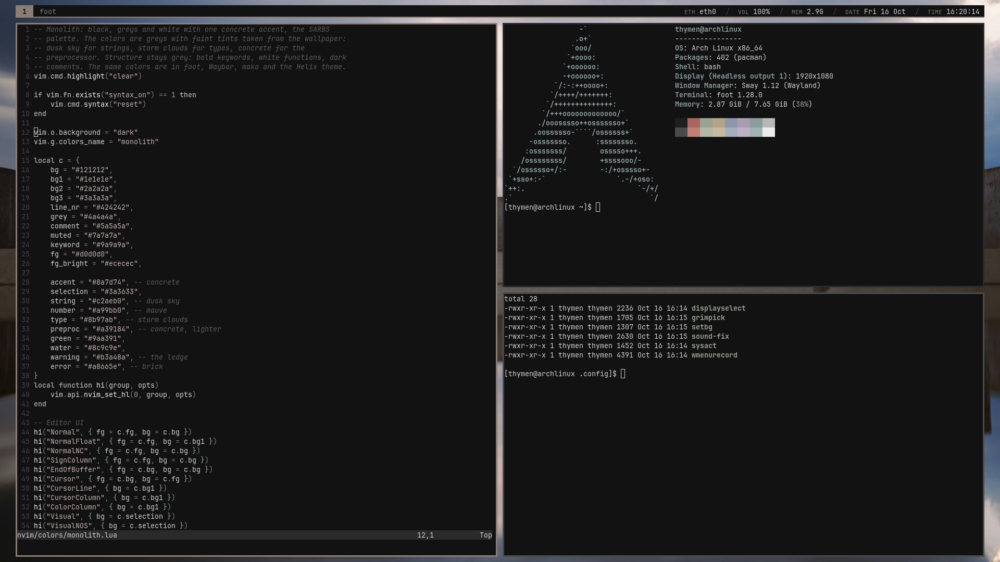
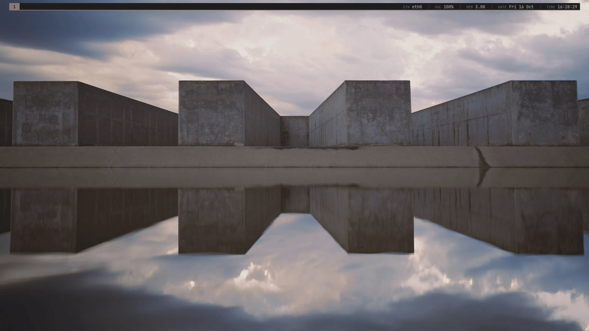

# Sway Auto Rice Bootstrapping Script (SARBS)



My dotfiles for sway, Waybar, foot, mako, wmenu, swaylock and swaynag, with Neovim and Helix themes. Everything uses **Monolith**: a flat, mostly black, grey and white palette with one concrete accent, made around the brutalist wallpaper. It sticks to sway's own tools: wmenu instead of rofi, and the default sway key bindings with a few additions.



## Install

For Arch and Arch based distributions, Fedora, and Artix with dinit. **Read a script before you run it.** Run it as your own user, not as root; it uses `sudo` where needed.

```bash
git clone https://github.com/tcvscheppingen/SARBS.git
cd SARBS
./auto-rice.sh        # on Artix: ./auto-rice-artix.sh
```

Then reboot. The script:
- installs sway and its tools, PipeWire, NetworkManager, Bluetooth, the portals, fonts, Neovim, Thunar and LibreWolf
- backs up the configs it replaces to `~/.config/sarbs-backup-<date>/`
- copies the dotfiles to `~/.config` and the scripts to `~/.local/bin`
- asks how to start sway: on login on TTY1, or from a minimal LightDM login screen (`RICE_LOGIN=tty|dm|none` answers in advance)

Already have the packages? `./move-config-files.sh` only copies the dotfiles.

<details>
<summary>Manual installation</summary>

Arch:
```bash
sudo pacman -S --needed sway swaybg swaylock swayidle wmenu foot waybar mako xorg-xwayland \
    pipewire pipewire-pulse pipewire-jack wireplumber libpulse \
    xdg-desktop-portal-wlr xdg-desktop-portal-gtk lxqt-policykit \
    networkmanager network-manager-applet bluez bluez-utils blueman \
    grim slurp wl-clipboard xdg-user-dirs brightnessctl playerctl jq libnotify file \
    wf-recorder ffmpeg \
    ttf-jetbrains-mono-nerd noto-fonts noto-fonts-emoji \
    adwaita-icon-theme adwaita-cursors dconf \
    neovim thunar librewolf
sudo systemctl enable NetworkManager bluetooth
```

Fedora (LibreWolf needs [its own repo](https://librewolf.net/installation/rhel/), and the font comes from the [nerd-fonts releases](https://github.com/ryanoasis/nerd-fonts/releases)):
```bash
curl -fsSL https://repo.librewolf.net/librewolf.repo | sudo tee /etc/yum.repos.d/librewolf.repo
sudo dnf install sway swaybg swaylock swayidle wmenu foot waybar mako xorg-x11-server-Xwayland \
    pipewire pipewire-pulseaudio wireplumber pulseaudio-utils \
    xdg-desktop-portal-wlr xdg-desktop-portal-gtk lxqt-policykit \
    NetworkManager network-manager-applet bluez blueman \
    grim slurp wl-clipboard xdg-user-dirs brightnessctl playerctl jq libnotify file \
    wf-recorder /usr/bin/ffmpeg \
    google-noto-sans-fonts google-noto-color-emoji-fonts \
    adwaita-icon-theme adwaita-cursor-theme dconf \
    neovim Thunar librewolf
sudo systemctl enable NetworkManager bluetooth
mkdir -p ~/.local/share/fonts/JetBrainsMonoNerdFont
curl -fL https://github.com/ryanoasis/nerd-fonts/releases/latest/download/JetBrainsMono.tar.xz | tar -xJ -C ~/.local/share/fonts/JetBrainsMonoNerdFont
```

Then copy the dotfiles:
```bash
xdg-user-dirs-update
mkdir -p ~/.config ~/.local/bin ~/.local/share
cp -a .config/. ~/.config/
cp -a .local/bin/. ~/.local/bin/
ln -s ~/.config/sway/wallpaper.jpg ~/.local/share/bg
```

If `~/.sway/config` exists, move it away: sway reads it before `~/.config/sway/config`.

</details>

<details>
<summary>What's different on Artix</summary>

`auto-rice-artix.sh`:
- updates the Artix and Arch keyrings first, so an older install doesn't fail on signatures
- adds Arch's `[extra]` repo for wmenu (as [LARBS](https://github.com/LukeSmithxyz/LARBS) does); everything else comes from the Artix repos
- enables the dinit services for elogind, D-Bus, NetworkManager and Bluetooth
- installs turnstile, which starts PipeWire, WirePlumber and the D-Bus session bus when you log in
- adds you to the `video` group for brightnessctl

</details>

<details>
<summary>Starting sway on login yourself</summary>

Add this to `~/.bash_profile` (or `~/.zprofile` for zsh):
```bash
if [ -z "$WAYLAND_DISPLAY" ] && [ -n "$XDG_VTNR" ] && [ "$XDG_VTNR" -eq 1 ]; then
    exec sway
fi
```

For fish, in `~/.config/fish/config.fish`:
```fish
if status is-login; and test -z "$WAYLAND_DISPLAY"; and test "$XDG_VTNR" = 1
    exec sway
end
```

Other TTYs keep a normal shell, so you can fix things from TTY2 if sway won't start. With a display manager such as GDM or SDDM, choose the Sway session on its login screen instead.

</details>

## Key bindings

The default sway bindings, plus:

| Keys | Action |
|---|---|
| `mod + w` / `mod + r` | Browser / file manager |
| `mod + q` | Close the window |
| `mod + u/p` / `mod + o/i` | Shrink or grow the width / height |
| `mod + n` / `mod + m` | Thin border / border with a title bar |
| `mod + x` | Lock the screen |
| `mod + Backspace` | System menu: lock, leave or reload sway, sleep, reboot, shutdown (`sysact`) |
| `mod + F3` | Display arrangement (`displayselect`) |
| `Print` / `ctrl + Print` | Screenshot of all screens, saved / copied |
| `shift + Print` | Screenshot menu: area, window or screen, saved or copied (`grimpick`) |
| `mod + Print` / `mod + Delete` | Start / stop a recording (`wmenurecord`) |
| `mod + Escape` (with `shift`) | Dismiss the newest (all) notifications |

`mod + w`, `mod + s` and the `mod + r` resize mode lose their default meaning.

## Good to know

- **Bar:** Waybar floats above the windows and reserves its space, so windows never go under it. Its layout is in `~/.config/waybar/config.jsonc`, its colors in `style.css`.
- **Locking:** after 5 minutes idle, and before sleep. The displays turn off after 10 minutes. The times are in `~/.config/sway/config`.
- **Wallpaper:** `setbg image.jpg` changes it, and `setbg folder` picks a random image from a folder.
- **No sound?** If the volume shows a "Dummy Output" on an Intel laptop, run `sound-fix`.
- **Screen recordings** go to `~/Videos`, screenshots to `~/Pictures`.

## Palette

Greys with faint tints from the wallpaper, told apart mostly by brightness.

| | Color | |
|---|---|---|
| Background | `#121212` | Bar, terminal, menus, editors |
| Text | `#d0d0d0` | |
| Muted | `#7a7a7a` | Labels, operators |
| Accent: concrete | `#8a7d74` | Focused window, active workspace, the line under the bar |
| Strings: dusk sky | `#c2aeb0` | |
| Types: storm clouds | `#8b97ab` | |
| Numbers: mauve | `#a99bb0` | |
| Errors: brick | `#a8665e` | Errors, recording, critical notifications |

The Neovim and Helix themes are `~/.config/nvim/colors/monolith.lua` and `~/.config/helix/themes/monolith.toml`. The script doesn't install [Helix](https://helix-editor.com); the theme is used once you do.

## Credits
- Wallpaper: [a reflection of a building in a body of water](https://unsplash.com/photos/a-reflection-of-a-building-in-a-body-of-water-1jyHQxBAE7A) on Unsplash
- `sysact`, `displayselect`, `wmenurecord`, `grimpick` and `setbg` are Wayland versions of scripts from Luke Smith's [voidrice](https://github.com/LukeSmithxyz/voidrice)
